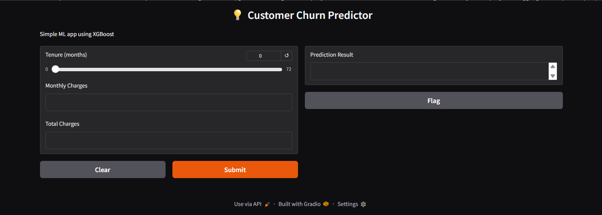
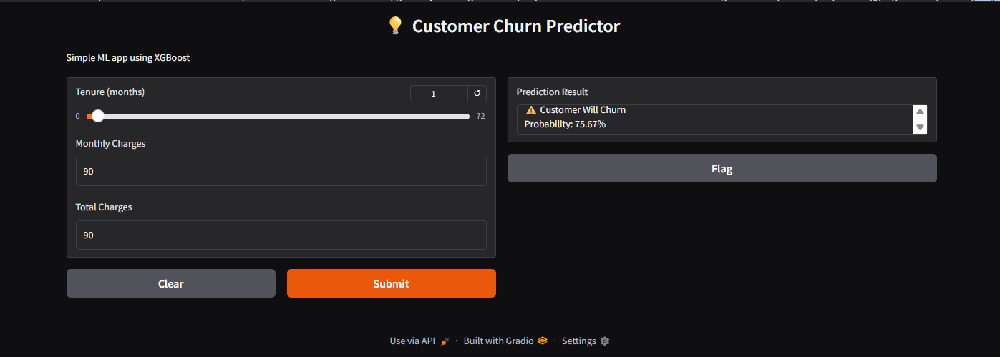
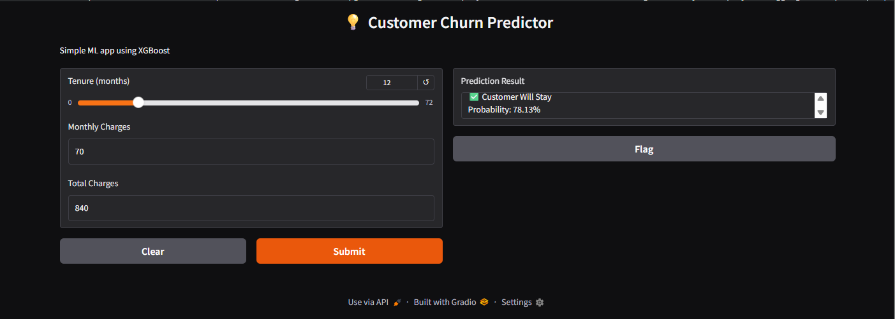

# Customer Churn Prediction System

A Machine Learning-based Customer Churn Prediction System that predicts whether a telecom customer is likely to leave a service based on their tenure, monthly charges, and total charges.

The project uses **XGBoost Classification** for prediction and provides a user-friendly interface built using Flask and HTML.

## Features

- Predicts whether a customer is likely to churn or stay.
- Uses an XGBoost classification model.
- Accepts customer details through an interactive interface.
- Displays prediction results.
- Provides churn probability through the Gradio demo.

## Tech Stack

- **Programming Language:** Python
- **Machine Learning:** XGBoost
- **Libraries:** Pandas, NumPy, Scikit-learn
- **Backend:** Flask
- **Frontend:** HTML
- **Model Serialization:** Pickle
- **Development Environment:** Google Colab

## Dataset

The project uses the Telco Customer Churn dataset.

The following features are used for prediction:

| Feature | Description |
|---|---|
| Tenure | Number of months the customer has stayed |
| Monthly Charges | Monthly amount charged to the customer |
| Total Charges | Total amount charged throughout the subscription |

**Target Variable:**
- `1` – Customer Will Churn
- `0` – Customer Will Stay

## Project Workflow

1. Data collection and preprocessing.
2. Handling missing values and converting categorical target labels into numerical values.
3. Selecting relevant customer features.
4. Training an XGBoost classification model.
5. Evaluating model performance.
6. Saving the trained model using Pickle.
7. Integrating the model with a Flask web application.
8. Generating predictions based on customer inputs.

## Application Screenshots

### 1. Customer Churn Prediction Interface

The interface allows users to enter customer details such as tenure, monthly charges, and total charges.



### 2. Customer Will Churn

Example prediction where the model identifies a customer as likely to churn.

**Prediction:** Customer Will Churn

**Probability:** 75.67%



### 3. Customer Will Stay

Example prediction where the model identifies a customer as likely to continue using the service.

**Prediction:** Customer Will Stay

**Probability:** 78.13%



## Project Structure

```text
Customer-Churn-Prediction/
│
├── app.py
├── churn_model.pkl
├── templates/
│   └── index.html
├── screenshots/
│   ├── interface.png
│   ├── churn-prediction.png
│   └── stay-prediction.png
├── Customer_Churn_Prediction_System.ipynb
├── requirements.txt
├── .gitignore
└── README.md
```

## Installation and Setup

### 1. Clone the Repository

```bash
git clone https://github.com/aishwaryavaidya05/customer-churn-flask-xgboost.git
```

```bash
cd customer-churn-flask-xgboost
```

### 2. Install Dependencies

```bash
pip install -r requirements.txt
```

### 3. Run the Application

```bash
python app.py
```

### 4. Open in Browser

Visit:

```text
http://127.0.0.1:5000/
```

Enter the customer details and click **Predict** to view the result.

## Future Improvements

- Incorporate additional customer attributes to improve prediction performance.
- Add more detailed customer churn analytics.
- Improve the user interface and responsiveness.
- Deploy the application on a cloud platform.

## Author

Developed as a Machine Learning project using Python, XGBoost, and Flask.
